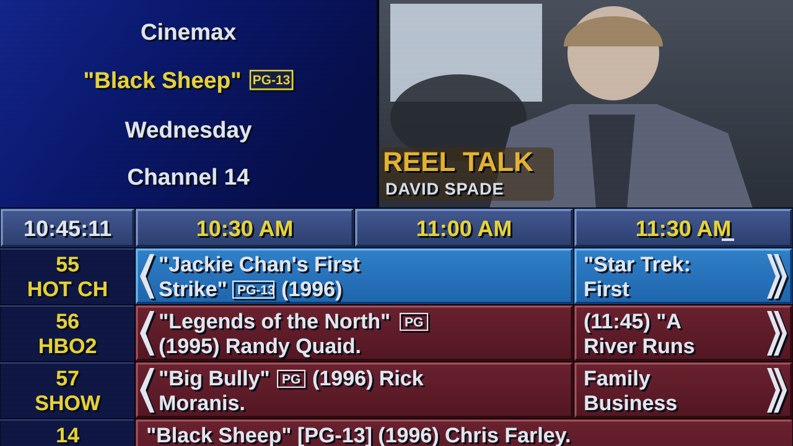
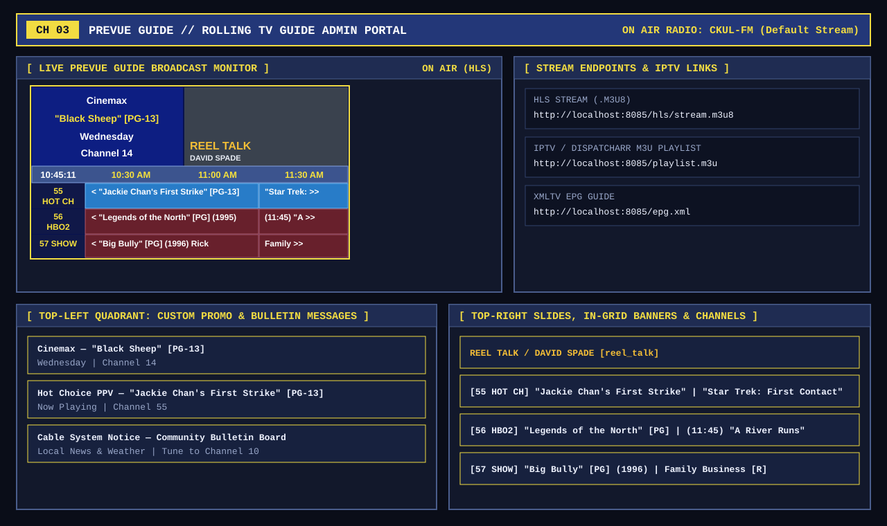
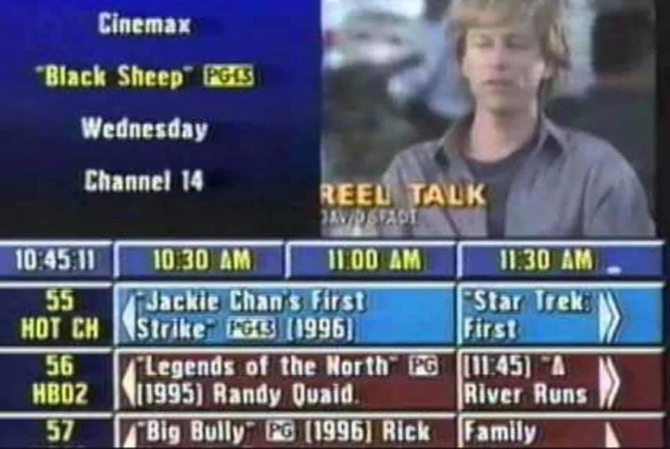

# Vintage Cable TV Rolling Program Guide (`cable-guide-hls`) 📺

A lightweight, self-contained Docker container that recreates the iconic **1990s Prevue Channel / Rolling Cable TV Guide** in full 24-bit colour, outputting a live **HLS stream** (`.m3u8` + `.ts` segments) with live background radio.

All **Top-Left promo & bulletin messages**, **Top-Right feature window slides**, **in-grid rolling announcement banners**, **channel schedules (custom or external XMLTV EPG)**, and **radio station presets** are controlled directly through the built-in **Admin Portal** and persisted to `/app/data/settings.json`.

Just like [`cable-bulletin-hls`](../cable-bulletin-hls), `cable-guide-hls` does **not** use Chromium or Puppeteer. Frames are rendered directly in 24-bit RGB using Python's Pillow library and piped straight into FFmpeg (`rgb24` -> `yuv420p` H.264), keeping CPU and memory usage minimal for 24/7 operation on Unraid, Docker hosts, or home servers.

---

## Screenshots

### Live HLS Broadcast Output (`/hls/stream.m3u8` & `/preview.png`)


### Built-In Admin Portal (`http://<host>:8085/`)


### Original 1990s Prevue Channel Reference Capture


---

## Screen Layout (1990s Prevue Guide Reference Style)

```text
+----------------------------------+--------------------------------------+
|             Cinemax              |                                      |
|      "Black Sheep" [PG-13]       |                                      |
|            Wednesday             |  REEL TALK                           |
|            Channel 14            |  DAVID SPADE                         |
+-------------+--------------------+------------------+-------------------+
|  10:45:11   |     10:30 AM       |     11:00 AM     |     11:30 AM   _  |
+=============+====================+==================+===================+
|     55      | < "Jackie Chan's First                | "Star Trek:    >> |
|   HOT CH    |   Strike" [PG-13] (1996)              | First          >> |
+-------------+---------------------------------------+-------------------+
|     56      | < "Legends of the North" [PG]         | (11:45) "A     >> |
|    HBO2     |   (1995) Randy Quaid.                 | River Runs     >> |
+-------------+---------------------------------------+-------------------+
|     57      | < "Big Bully" [PG] (1996) Rick        | Family         >> |
+-------------+---------------------------------------+-------------------+
```

1. **Top-Left Quadrant (Cobalt-Navy Promo & Custom Message Box)**:
   - Deep cobalt-navy background (`#0b1a74`) with vertical Amiga-style gradient shading.
   - Rotates through customizable 4-line Prevue promo/bulletin cards (`Cinemax` / `"Black Sheep" [PG-13]` / `Wednesday` / `Channel 14`) and optional RSS headlines.
2. **Top-Right Quadrant (Quarter-Screen Feature Window)**:
   - Displays rotating promo slides (either built-in retro broadcast scenes or custom image/webcam URLs) with the signature **Prevue Lower-Third Gold Overlay** (`REEL TALK` / `DAVID SPADE`).
3. **Middle Time Bar (3D Beveled Slate-Blue Clock & Time-Slot Header)**:
   - Left cell displays the live local clock (`10:45:11`), followed by three 30-minute time-slot headers (`10:30 AM`, `11:00 AM`, `11:30 AM`) in bright yellow with heavy black drop shadows.
4. **Bottom Half (Smooth Vertical Rolling TV Guide Grid)**:
   - Smoothly scrolls channel rows and interleaved custom announcement banners upward at 24 fps.
   - Features 3D beveled program bars in **Sky-Blue** (`55 HOT CH`), **Crimson-Red** (`56 HBO2`, `57 SHOW`), **Slate-Navy**, and **Teal**, complete with **left/right continuation chevrons (`<` / `>>`)** and inline boxed movie/TV rating badges (`[PG-13]`, `[PG]`, `[R]`).

---

## Admin Portal Features (`http://<host>:8085/`)

- **Top-Left Promo & Bulletin Messages**:
  - Add, enable/disable, or delete rotating 4-line Prevue promo cards and custom system notices (`Network/Header`, `Title/Message`, `Rating Badge`, `Day/Time`, `Channel/Callout`).
  - Optionally interleave headlines from up to **5 custom RSS feeds**.
- **Top-Right Feature Window Slides**:
  - Customize the lower-third gold title (`REEL TALK`), white subtitle (`DAVID SPADE`), backdrop theme, or link a custom image/snapshot URL.
- **In-Grid Rolling Announcement Banners**:
  - Add full-width custom message banners (`NOTICE`, `PPV INFO`, etc.) that scroll vertically inside the channel grid between channel cycles.
- **Channel Lineup & External XMLTV EPG Support**:
  - Point `xmltv_url` to any XMLTV EPG endpoint (e.g., **Dispatcharr**, **Jellyfin**, or custom XMLTV) to automatically populate live channels and schedules, and/or manage custom channels directly in the web UI.
- **Radio Station Presets & Live Audio Tuner**:
  - Save internet radio streams as presets and click **TUNE IN** to switch live HLS audio on the fly, or toggle between **Live Radio Stream** (`stream`), **60 Hz CRT Hum** (`hum`), and **Silent / Mute** (`silent`).

---

## Quick Start

```bash
docker compose up -d --build
```

Open **`http://localhost:8085`** to access the Admin Portal, customize your messages, channels, and radio presets, and watch the live HLS broadcast.

### Dispatcharr / Jellyfin / Plex / VLC Endpoints

| Path | Description |
| :--- | :--- |
| `/` | **Admin Portal** & live HLS broadcast monitor |
| `/hls/stream.m3u8` | **Primary HLS stream manifest** (`.m3u8`) |
| `/stream.m3u8` | Root alias for `/hls/stream.m3u8` |
| `/live.ts` *(or `/stream`)* | Continuous **MPEG-TS** HTTP stream (`video/mp2t`) |
| `/playlist.m3u` | **M3U Playlist** for Dispatcharr, Jellyfin, Plex, TiviMate, or VLC |
| `/epg.xml` | **XMLTV EPG** guide data for the Prevue Guide channel itself |
| `/preview.png` | Instant full-colour PNG snapshot of the current guide frame |
| `/health` | Container healthcheck endpoint |
